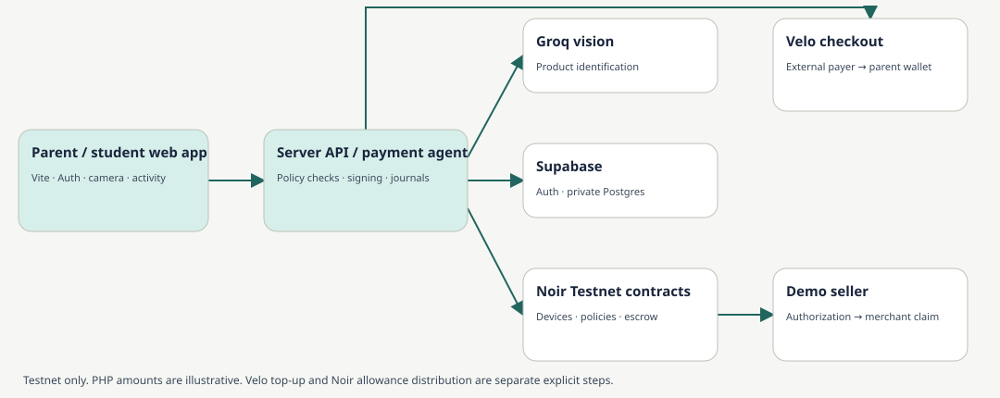
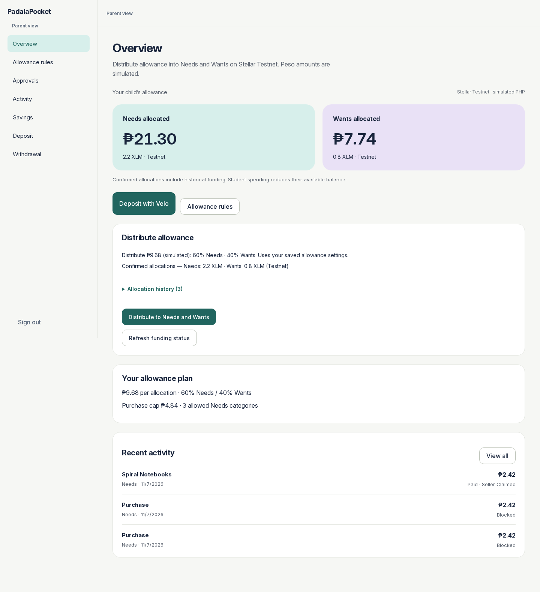
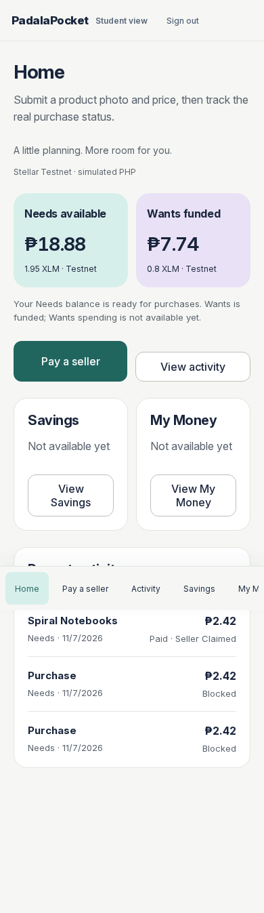

# PadalaPocket

An allowance payment agent for OFW parents and students: identify a purchase from a photo, enforce parent-selected rules, and pay a demo seller on Stellar Testnet.

**Live website:** https://padalapocket.vercel.app

**Demo video (2 min):**

**Team:** Tyrone Louis V. Teemer (Discord: ), Hedrix Bryan E. Barcelona (Discord: ), James Paul C. Soliven (Discord: ), Christian Louianne B. Lili (Discord: ). [Team roles](docs/team-roles.md).

> Testnet prototype for one parent, one student and one fixed seller. PHP values are simulated at the frozen ₱9.68/XLM mapping; Testnet XLM has no redeemable peso value. No real GCash payout. The public API health endpoint was checked on 2026-11-07; full parity of the latest local changes with production has not been reverified. The [implementation plan](docs/implementation-plan.md) owns task status.

## Problem

OFW parents sending a student allowance may want visibility into allowance purchases and limits they can agree on with their child. Students need a usable way to pay for everyday items within those boundaries. PadalaPocket explores that workflow; user demand and improved financial outcomes have not been validated.

## Solution

The parent signs in, saves an allowance amount, Needs/Wants split, purchase cap and allowed categories, and explicitly distributes Testnet funds into separate backed escrows. The student submits a product photo and price; the agent identifies the item and applies the selected bucket’s saved rules before attempting payment. Both roles can view actual allowance activity and authorized purchase photos.

Parent Deposit integrates Velo checkout for a top-up to the parent wallet before a separate Noir allocation. Matching-receiver checkout creation and status retrieval are verified; a paid parent top-up has not yet been observed. Wants purchases now have a connected local implementation with isolated rules, reservations and escrow selection; release evidence is tracked in [L-003](handoff/L-003.md). Parent approvals now have a connected local implementation with ten-minute expiry, immutable request review and isolated exception payments. A bounded Testnet exception was claimed and revoked with the routine policy unchanged. Savings releases, private My Money spending, weekly automation and in-app withdrawals remain unavailable. Approval release evidence remains in [L-002](handoff/L-002.md).

## How the agentic payment works

1. **Fund:** The parent distributes the saved allowance total. Integer rounding conserves the total; the Needs share and Wants remainder go to separate parent-owned Noir escrows. Neither allocation credit is available until both transfers confirm.
2. **Request:** The student chooses or captures a product photo, enters the price, and explicitly submits to the fixed demo seller. Price is supplied by the student, not inferred from the photo.
3. **Identify:** Groq vision returns a product name, supported category, uncertainty and restricted-item flags. Image text is untrusted. The [category catalog](apps/api/src/purchase-categories.mjs) separates produce, staple groceries, water and other everyday products from sweets and electronics.
4. **Decide:** Server rules check identification, parent-selected Needs categories, cap and sufficient available funds. Uncertain images and insufficient funds block payment. New over-cap/category-conflict requests reserve funds and wait up to ten minutes for a parent decision. Rejection/expiry releases the hold; approval uses an isolated exception escrow without increasing the routine cap. Payment advances through separately admitted transaction stages.
5. **Pay:** Reserve the amount, check actual escrow backing and policy, then use the Noir SDK to authorize exactly the mapped Testnet amount for the configured merchant. The recorded notebook purchase was ₱2.42 simulated / 0.25 XLM.
6. **Claim:** The server-held demo seller signer claims the authorized funds. Claimed requires ledger confirmation and a zero merchant-pending readback. Authorization alone is not seller receipt.
7. **Observe:** Save signed envelopes/hashes before submission, preserve reservations for unknown outcomes, and reconcile existing hashes without blindly replacing transactions. Photos and activity remain authenticated and family-scoped.

## Architecture



[Architecture](docs/architecture.md) owns the stack and system design; [technical specification](docs/technical-spec.md) defines detailed contracts. The frontend cannot sign or set settlement status. The demo uses server-held, Testnet-only parent, agent and seller keys; this is not noncustodial production custody. App access controls do not hide transactions from the public Stellar ledger.

## Noir integration

**SDK:** `@noirx402/agent-sdk` **0.3.0**, with `@stellar/stellar-sdk` **16.0.1**. Dependencies are pinned in [apps/api/package.json](apps/api/package.json).

| Contract | Calls and source |
|---|---|
| `device_registry` | `getDeviceOwner` and `prepare` with `registerDevice` for family bucket devices: [funding.mjs](https://github.com/DiceTL/PadalaPocket/blob/main/apps/api/src/funding.mjs#L65). |
| `agent_registry` | `prepare` with `registerAgent` establishes a finite cap and expiry: [purchase-providers.mjs](https://github.com/DiceTL/PadalaPocket/blob/main/apps/api/src/purchase-providers.mjs#L39). |
| `payment_escrow` | `prepare` with `fundEscrow`, escrow balance reads and `submit`: [funding.mjs](https://github.com/DiceTL/PadalaPocket/blob/main/apps/api/src/funding.mjs#L70). Purchase `checkPayment`, `authorize`, `claim`, `getPendingBalance`, signing and `submit`: [purchase-providers.mjs](https://github.com/DiceTL/PadalaPocket/blob/main/apps/api/src/purchase-providers.mjs#L32). |

The SDK selects the deployed Testnet contracts. [purchases.mjs](apps/api/src/purchases.mjs) coordinates reservations, exact operation persistence, confirmation and one-time merchant claim admission. Routine payments submit directly through Noir; Velo does not currently sponsor their fees.

## Velo integration

**SDK:** `@carts1024/velo-sdk` **0.1.0-alpha.4**, server-side only.

- Parent **Deposit** calls authenticated `/api/velo-topups` to create a native-XLM Testnet checkout using `velo.checkout.sessions.create`: [velo-topups.mjs](https://github.com/DiceTL/PadalaPocket/blob/main/apps/api/src/velo-topups.mjs#L46).
- The server retrieves `velo.paymentIntents.retrieve` to verify status, exact amount, asset, intent identity and parent receiving wallet: [validation and observation](https://github.com/DiceTL/PadalaPocket/blob/main/apps/api/src/velo-topups.mjs#L10).
- Checkout identities and idempotency keys are journaled in private Postgres before dispatch. Browser callbacks never mark a top-up paid. Mismatched receiving wallets withhold the payment link.
- Velo pays the project owner wallet. Its project must be owned by the same parent wallet configured by `OWNER_SECRET`. Use a different funded Testnet wallet to pay the checkout. A separate explicit action distributes the resulting parent funds through Noir.
- The current parent-owned project returned a correctly routed 1-XLM checkout. A paid parent top-up remains unverified. An earlier, separately configured Velo checkout has paid evidence below; it is not evidence that the current parent wallet received funds.

No webhook receiver is implemented. Gas Station was investigated earlier but did not complete the Noir handoff; no current fee sponsorship is claimed. [Velo implementation evidence](handoff/L-006.md).

## Testnet proof

These recorded transactions were confirmed during the demo work on 2026-11-07. Explorer availability depends on retained Testnet history.

| Operation | Stellar Expert transaction | Result |
|---|---|---|
| Agent authorizes notebook purchase, 0.25 XLM | [44d5782d…320629c](https://stellar.expert/explorer/testnet/tx/44d5782d8220cd24e23ce00201a138aeb5f6ac95d5d87b2cad5d252bf320629c) | Confirmed authorization; merchant pending increased. |
| Demo seller claims the purchase | [dff1ebb6…4631d20](https://stellar.expert/explorer/testnet/tx/dff1ebb69cf4d732446fc4ff7d59df79453f97a1a72f1e20e6a9a16944631d20) | Confirmed claim; merchant pending returned to zero. |
| Parent allocates 0.6 XLM to Needs | [388ad8fb…5ed85a2](https://stellar.expert/explorer/testnet/tx/388ad8fb1749a9d01ed540eff84ad58824839875ff89d48c4debfef3e5ed85a2) | Confirmed allocation. |
| Parent allocates 0.4 XLM to Wants | [8f1e9b5b…2bd7599](https://stellar.expert/explorer/testnet/tx/8f1e9b5bb66e055b47f590f9b41e303f0675a97ec446130ad3c2eab232bd7599) | Confirmed allocation. |
| Earlier separate Velo checkout, 0.10 XLM | [d365092b…e95814](https://stellar.expert/explorer/testnet/tx/d365092ba91e45b2bce888e4d1828942f8133fe5b6cf0b7b67cfc1dd83e95814) | Paid historical checkout; separate from current parent top-up. |

Recorded verification: [photo-to-claim](handoff/R-002.md), [allocation](handoff/L-003A.md), [Velo](handoff/L-006.md). No real peso settlement is established by these hashes.

## Repo structure

```text
apps/web/             Vite browser app, responsive views, camera and explicit design previews
apps/api/             Authenticated API, AI/rules, funding, Noir/Velo integrations and tests
api/                  Vercel function entry point
supabase/migrations/  Ordered Postgres schema, access controls and durable journals
docs/                 Architecture, contracts, setup, decisions, screenshots and task status
handoff/              Scoped task requirements and recorded verification evidence
seed/                 Product context and immutable original handbook/design inputs
work/                 Problem capture and sourced research evidence
guides/               Repository delivery and agent guidance
```

The root [package.json](package.json) declares npm workspaces; one root install covers both apps. No new custom Soroban contracts are deployed by this repository.

## Run it locally

Use a fresh Supabase project and Testnet-only accounts. Existing production signers and credentials are not supplied in the repository.

1. **Prerequisites:** Node **26.12.1 or later 26.x**, npm **12.2.1**, Git, a Supabase project, a Groq vision API key, and three distinct Stellar Testnet accounts (owner, agent, merchant) funded with Testnet XLM for principal, fees and reserves. Create/fund test accounts using [Stellar Laboratory](https://lab.stellar.org). For Velo, use an active Velo Pay project owned by the owner account and a General project API key. Connect a supported wallet such as Albedo for checkout.
2. **Clone and install all workspaces:**
   ```sh
   git clone https://github.com/DiceTL/PadalaPocket.git
   cd PadalaPocket
   npm ci
   cp .env.example .env.local
   ```
3. **Configure `.env.local`:** Fill in the required variables from the table below. Keep all keys private. Do not change the owner signer after creating funded bucket escrows; a different signer cannot own those existing devices.
4. **Initialize the database:** Using the Supabase CLI, initialize local configuration, log in, link your fresh project, and apply the checked-in migrations in order:
   ```sh
   npx supabase init
   npx supabase login
   npx supabase link --project-ref YOUR_PROJECT_REF
   npx supabase db push
   ```
   These commands target your own Supabase project; they do not deploy the web app. The CLI may request its database password. Do not reset a populated database to try this demo.
5. **Provision the demo parent/student accounts:**
   ```sh
   node --env-file=.env.local apps/api/scripts/provision-identity.mjs
   ```
   Open the generated, ignored `.env.r001-accounts.json` privately for the two login emails/passwords. Do not commit it. The app has no self-service signup; roles come from trusted family membership, not a browser role switch.
6. **Start the API from the repository root:**
   ```sh
   node --env-file=.env.local apps/api/src/dev.mjs
   ```
7. **In another terminal, start the web app:**
   ```sh
   npm run dev --workspace @padalapocket/web -- --port 5174 --strictPort
   ```
   Open http://127.0.0.1:5174. The frontend proxies `/api` to port 3001. Sign in as parent to save rules, use Velo Deposit or distribute funds; sign in as student to submit a Needs purchase and view activity. Camera capture needs localhost or HTTPS and browser permission; Choose a photo is the fallback.
8. **Check the repository:** `npm run check`. This runs fixture checks, unit tests and builds; it does not create live AI requests or payments. The app defaults to live mode. For the isolated mock shell, set `VITE_APP_MODE=mock` for development; sample layouts require `?preview=design&layout=home`.

The latest live flows were checked locally against hosted services; a new independent-project/fresh-clone end-to-end run has not yet been verified. Do not treat historical operator scripts as automatic app recovery. Unknown money operations stay blocked pending investigation. [Extended setup and deployment notes](docs/development.md).

## Environment variables

Required live values go in ignored `.env.local` locally and server environment settings when deployed. Only URL/publishable configuration may reach the browser.

| Name | What it is | Where to get it |
|---|---|---|
| `SUPABASE_URL` | Supabase project URL; also used by Vite as public URL fallback | Supabase project settings |
| `SUPABASE_PUBLISHABLE_KEY` | Public key for Auth; also Vite public key fallback | Supabase API settings |
| `SUPABASE_SECRET_KEY` | Server-only privileged database/provisioning key | Supabase API settings |
| `VITE_SUPABASE_URL` | Optional explicit public browser URL override | Same Supabase project URL |
| `VITE_SUPABASE_PUBLISHABLE_KEY` | Optional explicit public browser key override | Same publishable key; never use a secret key |
| `OWNER_SECRET` | Testnet parent funding signer | Your newly created funded Stellar Testnet account |
| `AGENT_SECRET` | Separate Testnet purchase agent signer | Your second funded Testnet account |
| `MERCHANT_SECRET` | Fixed demo seller signer | Your third funded Testnet account |
| `GROQ_API_KEY` | Server-only product-photo identification access | Groq Console; account must support the configured vision model |
| `VELO_API_KEY` | General project API key for Testnet checkout/status | Velo project owned by the parent funding wallet; activate Velo Pay first |
| `VITE_APP_MODE` | Optional `mock` development opt-in | Set locally only when intentionally using mock data |

The additional Gas Station, Gemini and `PROOF_*` entries in [.env.example](.env.example) belong to optional historical proof scripts. They are not required for the current app flow. Velo checkout uses `VELO_API_KEY`, not `VELO_GAS_API_KEY`. Never commit `.env.local`, generated account files, signing envelopes or API keys. Changing a local key does not update Vercel: set its server environment variable and redeploy there too.

## Screenshots

Actual signed-in **local Testnet** views, captured during verification. These are not evidence of production deployment or real peso balances.

### Parent overview



### Student home on mobile



## What's next

- Record and link the required two-minute demo, add registered Discord handles, and rehearse the public deployment.
- Verify a paid Velo parent-wallet top-up through hosted checkout and subsequent Noir distribution.
- Complete release verification for Wants purchases; connect Savings releases and private My Money spending.
- Connect Savings releases, private My Money spending, weekly scheduling/rollover and in-app test-anchor withdrawal.
- Improve progress feedback for sequential Testnet confirmations and establish safe operator recovery for interrupted operations.
- Verify supported photo categories on real images; model identification is fallible and does not prove price, delivery or medical/health properties.

Existing exception, wallet-topology and anchor experiments are feasibility evidence, not finished app features. No production custody, financial compliance or real GCash payout is claimed.

## Credits

- [Noir](https://github.com/noirx402/noir) and `@noirx402/agent-sdk` for deployed agent-payment contracts and SDK.
- [Velo](https://github.com/Velo-Ecosystem-Collection/Velo) and `@carts1024/velo-sdk` for hosted checkout and payment-status integration.
- [Stellar](https://github.com/stellar/js-stellar-sdk), Testnet/Friendbot and Stellar Expert for signing, test funds, ledger access and transaction evidence.
- Supabase Auth/Postgres, Groq vision, Sharp, Vite and npm workspaces.
- The team-supplied Figma layouts guided the interface; delegated additions and responsive changes are recorded in [design brief](docs/design-brief.md).
- Self-hosted Inter: [font license](apps/web/public/fonts/Inter-LICENSE.txt).
- Illustrative design-preview notebook photo by Mk2010, CC BY-SA 3.0: [source and attribution](apps/web/public/demo-photos/README.md). It is not substituted for private purchase evidence.
- AI-assisted implementation and documentation were reviewed through repository checks and recorded demo verification; this does not establish production security or validated market demand.
- Event requirements come from the supplied [Velo + Noir Builder Handbook](seed/sources/velo-noir-builder-handbook.md); its original DOCX is preserved in seed/sources/. [AGENTS.md](AGENTS.md), [routing](AGENT_ROUTING.md), [decision ledger](docs/decision-ledger.md) and [research](work/evidence-ledger.md) retain project context.

L-002 parent approvals are implemented locally under [DEC-084](docs/decision-ledger.md); see [the packet](handoff/L-002.md) for current verification limits. The owner signs each isolated exception; routine agent policy remains unchanged.
