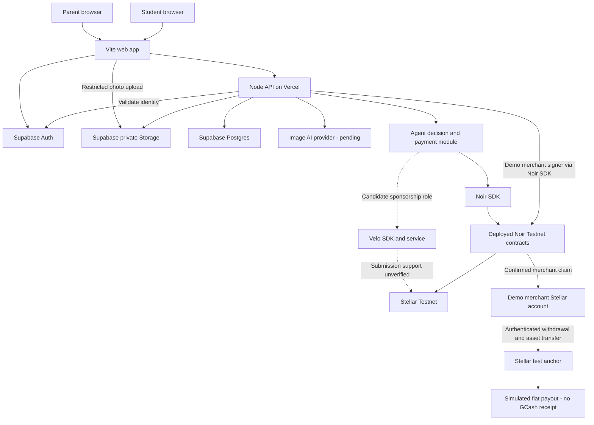

# PadalaPocket architecture

Updated 2026-11-06 under [DEC-031](decision-ledger.md). This is the canonical system overview, stack and diagram. It describes the working design under DEC-030. Under DEC-035, S-001 infrastructure is implemented locally; deployment and product integrations remain unverified. Product requirements live in [product spec](product-spec.md); detailed API/data/execution contracts live in [technical spec](technical-spec.md); progress lives in [implementation plan](implementation-plan.md).

## Maintenance rule

Whenever an architectural decision changes components, stack, hosting, data ownership, signing, integrations or money routing: record the decision in the ledger first, update this document and diagram in the same change, and align affected technical-spec/context/README references. Add evidence links when a proposed connection is verified or rejected. Do not present an experiment as implemented architecture. These instructions are enforced through [project instructions](../AGENTS.md) and [routing](../AGENT_ROUTING.md), rather than an automated file watcher.

## Working stack

Designed for two JavaScript-capable builders and the team's under-30-hour implementation target; this is not a duration guarantee. Team experience and competition constraints remain in [context](../seed/context.md).

| Area | Working baseline | Reason / boundary |
|---|---|---|
| Frontend | Vite 8.3.6, vanilla JavaScript, HTML and CSS | Shared existing skills; no framework learning dependency. Visual design remains with the human designer under [design brief](design-brief.md) |
| Backend | JavaScript ESM, Node.js API functions on Vercel | Same language as browser; required payment SDKs run in Node. No separate Python service or Express server |
| Data and identity | Supabase Postgres, Auth and private Storage | Founder familiarity; central transactional balances, permissions and photos |
| Payment | Noir 0.3.0, Velo 0.1.0-alpha.4, Stellar SDK 16.0.1 | Exact versions locally installed/imported; retain handbook's Velo alpha choice. Use required deployed Testnet contracts |
| Image identification | Server-side image-capable AI API; provider/model pending | Real photo identification required. Never expose provider credentials or treat AI text as payment authorization |
| Simulated off-ramp | Stellar reference test anchor, SEP-10/SEP-24 flow | Demonstrate authenticated test withdrawal; no real PHP or GCash settlement |
| Repository | npm workspaces: `apps/web`, `apps/api` | Workspace manifests and root lockfile now exist under S-001. Pin installed dependencies. No shared package until actual reuse requires it |

Runtime evidence and exact engine ranges live in [EV-025](../work/evidence-ledger.md). Use local Node 26.12.1; target Vercel Node 26.x and verify both deployed build and function patch versions. Browser code calls our API; payment SDKs and signing stay server-side. Prefer same-origin `/api` routing; validate Vite output and Vercel function routing in the first deployment. Hosting duration/plan remains unverified.

## Component diagram

All connections are proposed application connections. Dashed arrows highlight particularly unresolved external integration paths; solid arrows do not imply completed implementation. The agent is a module inside the backend, not a separately hosted service.

The required contracts are `device_registry`, `agent_registry` and `payment_escrow`; identifiers remain in [the extracted handbook](../seed/sources/velo-noir-builder-handbook.md#using-noir). The diagram deliberately does not imply that Velo standard checkout recognizes Noir contract payments. The handbook's reference architecture leaves their connection to the project; our proposed sponsorship role still needs a real execution proof.

## Responsibilities and boundaries

| Component | Responsibility | Authority boundary |
|---|---|---|
| Web app | Parent/student input, Auth, photos, displaying server outcomes | Cannot decide final permissions, edit balances or hold payment secrets |
| Node API and agent module | Authenticate/authorize, apply spending rules, obtain AI assessment, execute permitted actions, reconcile results | AI classifies images; application policy decides and signers execute. No direct AI authority over keys |
| Supabase | Application records, memberships, bucket accounting and private photo evidence | Database balances require reconciliation with ledger-backed holdings; My Money app access is student-only |
| Noir contracts | Device ownership, constrained agent policy, escrow authorization and merchant claim | Parent approval in the app does not by itself bypass contract policy |
| Velo | Required additional SDK integration; sponsorship is the current candidate | Successful SDK import proves no live service/envelope compatibility |
| Test anchor | Test withdrawal protocol and simulated off-chain completion | No production peso exchange or GCash payout |

Server custody for separate owner, agent and merchant Testnet signers is a proposal; exact signing permissions, request binding and recovery live in [technical spec](technical-spec.md#signing-and-integration-proof). Public Stellar activity may reveal wallet relationships despite private My Money app records. Physical wallet/escrow layout remains unresolved.

Early proof access under DEC-033: B-001 uses an operator-only CLI calling a server endpoint protected by a high-entropy environment token in the Authorization header, validated before signing. Keep the token out of browser code, URLs and logs, with fixed demo destination and bounded amount. This temporary route is disabled when B-005 implements real parent/student Auth and operator authorization; it is not the application's user login design. The implementation plan is canonical for task order.

## Main flow and unresolved money routing

1. Parent configures the allowance; backend validates and records the rules. Weekly demo funding must produce confirmed backing transfers before displaying funded balances.
2. Student submits seller, amount and allowance photo. Backend obtains AI identification and applies balance/category/cap rules. Parent reviews exceptions before payment authorization; My Money follows its separate unrestricted product rules.
3. Agent calls Noir through its SDK. Authorization debits escrow into merchant pending funds; the merchant signer claims those funds into its wallet. Store both confirmed results separately.
4. The merchant account starts an authenticated test-anchor withdrawal and follows returned transfer instructions. Record the actual anchor status and disclose simulated fiat completion.
5. Week-end Needs/Wants movements and Savings release must use a verified backing/signing path. Logical buckets are defined in the product spec; this document does not yet assign each bucket a distinct physical wallet.

Before treating this design as ready for implementation, resolve the parent-approved over-cap contract path, Velo's actual role/access, escrow withdrawal constraints and Savings/My Money layout, AI provider/access, recipient QR mapping, demo exchange/rounding rules, and hosted execution recovery. Detailed experiments and limitations remain in [technical spec](technical-spec.md#signing-and-integration-proof) and [evidence ledger](../work/evidence-ledger.md). Local Node install/import is the completed runtime evidence (EV-025); no end-to-end payment or authenticated anchor withdrawal has been verified.

## Competition presentation

The handbook requires an Architecture diagram in the root README showing the apps, agent, Noir contracts and Velo. Use this document as the canonical reference; when preparing the submission, include a diagram reflecting the actual verified build in the README and link back here. Do not submit this proposed diagram as proof of working integration. See [required README format](../seed/sources/velo-noir-builder-handbook.md#repo-and-readme-format).

## Shared setup implementation boundary

S-001 adds a blank web entry (no product interface), Vite development `/api` proxy, a Node health handler and root `api/index.js` bridge required by the proposed Vercel configuration. Health reports Testnet/runtime only and performs no signing/provider action. Node built-in tests and a PR workflow are present; no browser interaction runner is chosen yet. `scripts/check-contracts.mjs` reports no fixtures and rejects unexpected JSON fixtures until S-002 adds validation. See [development setup](development.md) and [S-001 evidence](../handoff/S-001.md). The diagram above continues to represent the future product components, not completed integration.
